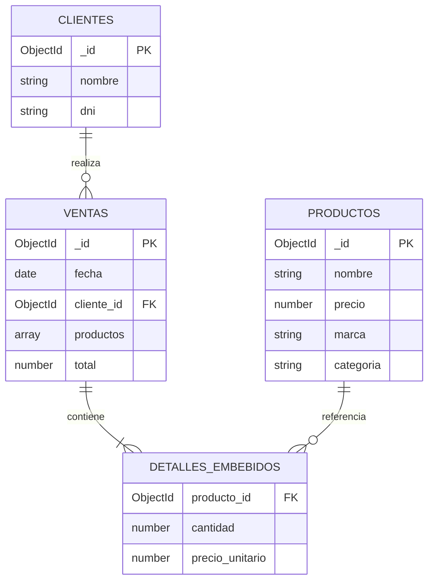

# Diseño de datos

Base: `tienda_computadoras`. MongoDB guarda documentos BSON en las colecciones `productos`, `clientes` y `ventas`. El diagrama representa sus relaciones conceptuales.

`DETALLES_EMBEBIDOS` representa los elementos de `ventas.productos`; **no es una colección**.

## Modelo lógico

- `productos`: `{ _id, nombre, precio, marca, categoria }`.
- `clientes`: `{ _id, nombre, dni }`.
- `ventas`: `{ _id, fecha, cliente_id, productos: [{ producto_id, cantidad, precio_unitario }], total }`.

`cliente_id` referencia a `clientes._id` y cada `producto_id` a `productos._id`. MongoDB genera `_id` automáticamente; las referencias deben mantenerse desde la aplicación o los scripts, ya que no son claves foráneas impuestas por MongoDB.

## Diccionario de datos

| Colección | Campo | Tipo | Descripción |
|---|---|---|---|
| Todas | `_id` | ObjectId | Identificador único del documento. |
| productos | `nombre` | String | Nombre del producto. |
| productos | `precio` | Number | Precio de venta, mayor o igual a cero. |
| productos | `marca` | String | Marca del fabricante. |
| productos | `categoria` | String | Tipo de producto. |
| clientes | `nombre` | String | Nombre del cliente. |
| clientes | `dni` | String | Documento de identidad de 8 dígitos; conserva ceros iniciales. |
| ventas | `fecha` | Date | Fecha y hora de la venta. |
| ventas | `cliente_id` | ObjectId | Referencia al cliente. |
| ventas | `productos` | Array de objetos | Detalles de la venta, al menos uno. |
| ventas | `productos[].producto_id` | ObjectId | Referencia al producto vendido. |
| ventas | `productos[].cantidad` | Number entero | Unidades vendidas, mayor que cero. |
| ventas | `productos[].precio_unitario` | Number | Precio al momento de la venta, mayor o igual a cero. |
| ventas | `total` | Number | Suma de cantidad × precio unitario de todos los detalles. |

El precio unitario se conserva aunque cambie el precio del catálogo. Estas reglas describen el modelo; el script de creación no agrega validadores ni altera documentos existentes.
